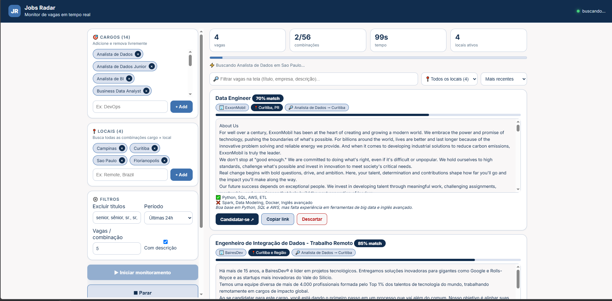

# Jobs Radar — Vagas Automáticas

Monitor de vagas em tempo real que varre o LinkedIn por todas as combinações **cargo × local** e mostra os resultados **ao vivo** na web, com filtro de títulos, extração de descrição e **análise de aderência ao seu currículo por IA (LLM)**.

## 📸 Demonstração



Painel com cargos e locais em chips, filtros, barra de progresso das combinações e cards de vaga com nota de match, descrição completa e ações (candidatar-se, copiar link, descartar).

## ✨ Funcionalidades

- **Busca em tempo real via Server-Sent Events** — as vagas aparecem uma a uma, sem recarregar a página.
- **Combinações cargo × local** — adicione quantos cargos e locais quiser; o monitor varre todas as combinações e mostra o progresso.
- **Filtros de ruído** — lista de termos a excluir no título (sênior, gerente, estágio...), período (24h / semana / mês / sem filtro), vagas por combinação e toggle de descrição.
- **Filtro de local inteligente** — mantém vagas remotas/híbridas e descarta as de outra cidade (comparação sem acento).
- **Filtro positivo de título** — o título precisa ter relação com o cargo buscado (sinônimos pt/en e cluster de dados: BI, analytics, ETL...).
- **Extração de descrição** — busca a descrição completa da vaga logo após o card aparecer.
- **Aderência CV × vaga (LLM)** — envie seu currículo em PDF e receba nota 0–100 com `tem` / `falta` / `motivo`, em rodízio de modelos Groq com pausa anti rate-limit.
- **Nota mínima de match** — esconde automaticamente vagas abaixo do limiar.
- **Ferramentas do card** — filtrar na tela, ordenar (recentes / maior aderência / A–Z), filtrar por local, copiar link e descartar vaga.
- **Interface responsiva** — layout em duas colunas que vira coluna única no mobile.

## 🛠️ Tecnologias

| Camada | Tecnologia |
| --- | --- |
| Backend | Python 3.10+ (testado em 3.14), Flask 3 |
| Tempo real | Server-Sent Events (`text/event-stream`) |
| Coleta | `requests` + BeautifulSoup4 (API pública de vagas do LinkedIn) |
| IA | Groq API (modelos `openai/gpt-oss-*`, rodízio + JSON mode) |
| Currículo | `pypdf` (extração de texto de PDF) |
| Front-end | HTML + CSS + JavaScript puro (inline), fonte Inter |
| Layout | Grid CSS, sticky sidebar, CSS variables |

## 📦 Instalação

```bash
# 1. Clone o repositório
git clone https://github.com/<seu-usuario>/Vagas_Automaticas.git
cd Vagas_Automaticas

# 2. Crie e ative um ambiente virtual
python -m venv .venv
# Windows
.venv\Scripts\activate
# Linux/macOS
source .venv/bin/activate

# 3. Instale as dependências
pip install -r requirements.txt
```

## ⚙️ Configuração

O único segredo necessário é a chave da **Groq** (usada para calcular a aderência ao CV). Sem ela, a busca de vagas continua funcionando normalmente — apenas o match por IA fica desativado.

```bash
# Opção 1 (recomendada): variável de ambiente
set GROQ_API_KEY=sua_chave_aqui        # Windows
export GROQ_API_KEY=sua_chave_aqui     # Linux/macOS

# Opção 2: arquivo local (já ignorado pelo Git)
echo sua_chave_aqui > groq_key.txt
```

- Chave em: <https://console.groq.com/keys>
- `pypdf` é opcional: é necessário apenas para enviar o currículo em PDF pela interface.
- A interface avisa o status da chave no painel **📄 Aderência ao meu CV** (`LLM ok` / `sem chave`).

## 🚀 Como usar

```bash
python app.py
```

Abra <http://localhost:5000> e:

1. **Cargos** — adicione/remova cargos nos chips (há sugestões no autocomplete).
2. **Locais** — adicione cidades ou use `Remote` / `Brazil` para amplo.
3. **Filtros** — ajuste termos a excluir, período e vagas por combinação.
4. **▶ Iniciar monitoramento** — as vagas surgem ao vivo, com barra de progresso e cronômetro.
5. *(Opcional)* **📄 Aderência ao meu CV** — envie o PDF, marque *Calcular aderência (LLM)* e defina a nota mínima.
6. **⏹ Parar** — encerra o stream; use a barra de busca para filtrar o que já chegou.

> **Dica:** o filtro *Excluir títulos* já vem com uma lista longa de termos indesejados — edite livremente.

## 📁 Estrutura do projeto

```
Vagas_Automaticas/
├── app.py              # Interface web Flask (rotas + HTML/CSS/JS) ⭐
├── busca.py            # Motor de busca no LinkedIn + filtros de relevância
├── match.py            # Aderência CV × vaga via Groq (rodízio de modelos)
├── requirements.txt    # Dependências do projeto
├── img/
│   └── interface.PNG   # Captura da tela usada no README
├── README.md
├── LICENSE             # MIT
└── .gitignore          # Bloqueia scrapers, segredos e artefatos de debug
```

**Ignorados pelo Git** (mantidos apenas localmente): scrapers avulsos por board (`gupy.py`, `hays.py`, `infojobs.py`, `inhire.py`, `jobconvo.py`, `manpowergroup.py`, `solides.py`, `abler.py`, `roberthalf.py`, `page-personnel.py`, `indeed.py`, `michael-page.py`, `1 copy.py`), HTMLs de debug (`debug_*.html`), cache (`__pycache__/`) e dados sensíveis (`groq_key.txt`, `cv_text.txt`, `perfil_cv.txt`).

## 🧪 Testes

Ainda não há suíte automatizada. Checklist manual de regressão:

```bash
# 1. Sintaxe dos módulos versionados
python -m compileall app.py busca.py match.py

# 2. Servidor sobe
python app.py
# esperado: Serving Flask app ... http://127.0.0.1:5000
```

| # | Cenário | Esperado |
| --- | --- | --- |
| 1 | Abrir `http://localhost:5000` | Interface carrega com chips de exemplo |
| 2 | Iniciar com 1 cargo × 1 local | Status muda para `buscando`, cards surgem ao vivo |
| 3 | Desmarcar *Com descrição* | Cards aparecem sem o bloco de descrição |
| 4 | Enviar PDF do CV | Painel mostra `CV ok (N chars, M pág.)` |
| 5 | Marcar *Calcular aderência* com chave | Badge `% match` e lista `tem/falta` nos cards |
| 6 | Definir nota mínima | Vagas abaixo do limiar somem da lista |
| 7 | Botão *Parar* | Stream fecha, botão volta a ficar ativo |

## 🚢 Deploy

O app é um Flask puro, então roda em qualquer host WSGI:

```bash
pip install gunicorn        # Linux
gunicorn -w 2 -b 0.0.0.0:8000 app:app
```

- **Render / Railway / Fly.io / PythonAnywhere** — *Web Service* apontando para `app:app`, com `GROQ_API_KEY` nas variáveis de ambiente.
- **Atenção ao SSE:** o stream usa `Cache-Control: no-cache` e `X-Accel-Buffering: no`; em proxies/CDN, desative o buffering de respostas para não engasgar o progresso.
- **Docker (opcional):** imagem `python:3.12-slim`, `pip install -r requirements.txt`, `CMD ["python", "app.py"]`.
- Não exponha `groq_key.txt` na imagem/registro — use sempre variáveis de ambiente.

## 🗺️ Roadmap

- [ ] Unificar os scrapers por board (Gupy, InfoJobs, inHire, JobConvo, Solides, Hays...) atrás da mesma interface.
- [ ] Deduplicação e ranking agregado entre fontes.
- [ ] Alertas de novas vagas (e-mail / Telegram / WhatsApp).
- [ ] Dashboard histórico: vagas vistas, descartadas e candidaturas enviadas.
- [ ] Cache de buscas recentes para reduzir requisições e evitar rate-limit.
- [ ] Dockerfile + docker-compose prontos.
- [ ] Suíte de testes automatizados (pytest) e CI.
- [ ] Autenticação simples para uso em servidor compartilhado.

## 🤝 Contribuindo

1. Faça um *fork* do repositório.
2. Crie uma branch: `git checkout -b feature/minha-melhoria`.
3. Faça suas alterações e valide com `python -m compileall app.py busca.py match.py`.
4. Committe com mensagem clara: `git commit -m "feat: descreve a mudança"`.
5. Abra um *Pull Request* descrevendo o problema e a solução.

Siga as convenções do projeto: Python PEP 8, comentários em português e sem expor chaves ou dados de currículo no repositório.

## 📄 Licença

Distribuído sob a licença **MIT** — veja o arquivo [LICENSE](LICENSE) para detalhes.
